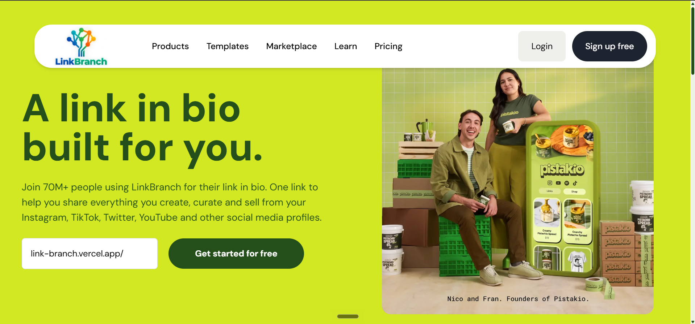

# LinkBranch

A Linktree-style link-in-bio app built with Next.js. Create one clean page that holds all your important links, and share it anywhere.



**Live Demo:** [link-branch.vercel.app](https://link-branch.vercel.app)

## Features

- Public profile page with profile picture, handle, link buttons and social icons
- One-click copy for your profile link
- Responsive navbar that hides on scroll down and returns on scroll up
- Mobile menu with a right-side sidebar
- Page loading animation and smooth Framer Motion transitions
- Bold, colorful landing page with full-width color sections
- Static pages for Products and other navbar sections

## Tech Stack

- **Framework:** Next.js (App Router, JavaScript)
- **Styling:** Tailwind CSS
- **Animations:** Framer Motion
- **Font:** DM Sans

## Getting Started

```bash
git clone https://github.com/saudus192/link-branch.git
cd link-branch
npm install
```

The project uses environment variables, copy the example file and fill in your own values:

```bash
cp .env.example .env.local
```

Then start the dev server:

```bash
npm run dev
```

Open [http://localhost:3000](http://localhost:3000) in your browser.

## License

Released under the [MIT License](./LICENSE).

## Author

**Saud Usman**, web developer (MERN Stack, Next.js).
GitHub: [@saudus192](https://github.com/saudus192)
